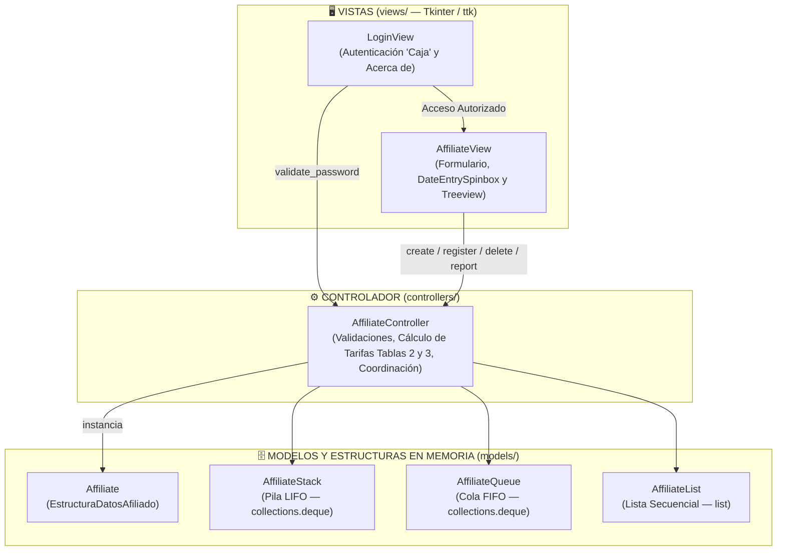

# Fase 3 — Componente Práctico: Prácticas Simuladas (`Fase3FabioGomez`)

**Universidad Nacional Abierta y a Distancia (UNAD)**  
**Escuela de Ciencias Básicas, Tecnología e Ingeniería (ECBTI)**  
**Programa:** Ingeniería de Sistemas  
**Curso:** Estructura de Datos (`301305`)  
**Grupo Colaborativo:** `301305_93`  
**Estudiante:** Fabio Alexmar Gomez Sanmiguel  
**Aplicación:** Caja de Compensación Familiar *"Compensándote"* — Control de Afiliados  

---

## 1. Tabla 1 — Elementos Sugeridos para la Abstracción (Anexo 2)

**Nombre del Estudiante:** Fabio Alexmar Gomez Sanmiguel  
**Planteamiento del Problema:** La Caja de Compensación Familiar *"Compensándote"* requiere una aplicación de escritorio con interfaz gráfica en Python (`Tkinter` / `ttk`), codificada en idioma inglés aplicando Programación Orientada a Objetos, Clean Code y principios SOLID bajo el patrón **MVC (Modelo-Vista-Controlador)**, que permita autenticar el acceso mediante la contraseña enmascarada `Caja`, capturar y validar los datos de afiliación de sus usuarios, calcular automáticamente la tarifa de afiliación según el nivel de ingresos, la modalidad de empleo (`Empleado` o `Independiente`) y el servicio deseado, y gestionar los registros en memoria principal mediante tres estructuras de datos lineales: **Pila** (`collections.deque` — LIFO), **Cola** (`collections.deque` — FIFO) y **Lista** (`list` — Secuencial), generando el reporte estadístico correspondiente a cada estructura.

| Nombre de la Clase y su Ámbito de Visibilidad (`Public` / `Private`) | Nombre de las Propiedades y/o Atributos de la Clase con sus Tipos de Datos | Tipo de Estructura que Soporta (`Pila`, `Cola` o `Lista`) | Acciones que Tendrá el Formulario de Ingreso de Datos (Métodos) |
| :--- | :--- | :--- | :--- |
| **Nombre de la clase:** `Affiliate` (Alias: `EstructuraDatosAfiliado`)<br>**Módulo:** `models/affiliate.py`<br>**Ámbito de visibilidad:** Pública<br>`Public Class Affiliate` | - `String id_type` (`CC`, `CE`, `NUIP`, `PAS`)<br>- `String id_number`<br>- `String full_name`<br>- `Float current_income`<br>- `String desired_service`<br>- `String employment_mode` (`Empleado`, `Independiente`)<br>- `Float affiliation_fee`<br>- `String affiliation_date` (`dd/mm/aaaa`) | **Entidad de datos** almacenada en memoria dentro de **Pila**, **Cola** y **Lista** | - `__init__()`: Inicializa los atributos inmutables del afiliado.<br>- `to_treeview_row()`: Retorna los atributos formateados como tupla para mostrar en el `Treeview`. |
| **Nombre de la clase:** `AffiliateStack`<br>**Módulo:** `models/structures.py`<br>**Ámbito de visibilidad:** Pública<br>`Public Class AffiliateStack` | - `deque items` (`collections.deque`) | **Pila (`Stack` — `collections.deque`)**<br>Comportamiento LIFO (*Last-In, First-Out*) | - `contains_id(id_number)`: Verifica si ya existe un afiliado con esa identificación en la pila.<br>- `push(affiliate)`: Apila un afiliado en el tope de la pila (`appendleft`).<br>- `peek()`: Obtiene el afiliado en el tope sin eliminarlo.<br>- `pop()`: Desapila y retorna el último afiliado ingresado (`popleft`).<br>- `get_total_fees()`: Calcula la suma de las tarifas de afiliación de la pila.<br>- `get_all()`: Retorna los registros actuales de la pila. |
| **Nombre de la clase:** `AffiliateQueue`<br>**Módulo:** `models/structures.py`<br>**Ámbito de visibilidad:** Pública<br>`Public Class AffiliateQueue` | - `deque items` (`collections.deque`) | **Cola (`Queue` — `collections.deque`)**<br>Comportamiento FIFO (*First-In, First-Out*) | - `contains_id(id_number)`: Verifica si ya existe un afiliado con esa identificación en la cola.<br>- `enqueue(affiliate)`: Encola un afiliado al final de la cola (`append`).<br>- `peek()`: Obtiene el primer afiliado de la cola sin eliminarlo.<br>- `dequeue()`: Desencola y retorna el primer afiliado ingresado (`popleft`).<br>- `get_record_count()`: Retorna la cantidad total de registros en la cola.<br>- `get_all()`: Retorna los registros actuales de la cola. |
| **Nombre de la clase:** `AffiliateList`<br>**Módulo:** `models/structures.py`<br>**Ámbito de visibilidad:** Pública<br>`Public Class AffiliateList` | - `list items` (`list`) | **Lista (`List` — `list`)**<br>Comportamiento secuencial | - `contains_id(id_number)`: Verifica si ya existe un afiliado con esa identificación en la lista.<br>- `add(affiliate)`: Agrega un afiliado al final de la lista (`append`).<br>- `find_by_id(id_number)`: Busca un afiliado por su número de identificación.<br>- `remove_by_id(id_number)`: Busca y elimina el afiliado por número de identificación.<br>- `get_average_income()`: Calcula el promedio de los ingresos actuales en la lista.<br>- `get_all()`: Retorna los registros actuales de la lista. |
| **Nombre de la clase:** `AffiliateController`<br>**Módulo:** `controllers/affiliate_controller.py`<br>**Ámbito de visibilidad:** Pública<br>`Public Class AffiliateController` | - `AffiliateStack stack`<br>- `AffiliateQueue queue`<br>- `AffiliateList affiliate_list` | **Coordina las 3 estructuras lineales:**<br>**Pila**, **Cola** y **Lista** | - `validate_password(password)`: Verifica que la clave ingresada sea `"Caja"`.<br>- `calculate_fee(current_income, employment_mode, desired_service)`: Calcula la tarifa según Tablas 2 y 3 y el recargo por servicio.<br>- `create_affiliate(...)`: Valida los campos de entrada y construye la instancia `Affiliate`.<br>- `register_affiliate(structure_type, affiliate)`: Inserta en Pila, Cola o Lista.<br>- `delete_affiliate(structure_type, target_id)`: Elimina según la estructura activa.<br>- `generate_report_text(structure_type)`: Genera el texto del reporte estadístico. |
| **Nombre de la clase:** `LoginView`<br>**Módulo:** `views/login_view.py`<br>**Ámbito de visibilidad:** Pública<br>`Public Class LoginView` | - `Tk root`<br>- `AffiliateController controller`<br>- `StringVar password_var`<br>- `Entry password_entry` | **N/A** *(Vista de autenticación inicial)* | - `login()` (**Ingresar**): Valida la contraseña `"Caja"`, cierra el Login y abre `AffiliateView`.<br>- `show_about()` (**Acerca de**): Muestra un cuadro de diálogo con el nombre del curso, nombre del estudiante y grupo colaborativo.<br>- `toggle_password_mask()`: Alterna el enmascarado `(*)` de la clave.<br>- `exit_app()` (**Salir**): Cierra la aplicación. |
| **Nombre de la clase:** `AffiliateView`<br>**Módulo:** `views/affiliate_view.py`<br>**Ámbito de visibilidad:** Pública<br>`Public Class AffiliateView` | - `Tk root`<br>- `AffiliateController controller`<br>- `Treeview treeview`<br>- `DateEntrySpinbox date_selector`<br>- `StringVar id_type_var`, `id_number_var`, `full_name_var`, `current_income_var`, `employment_mode_var`, `desired_service_var`, `affiliation_fee_var`, `structure_var`, `report_var` | **Visualiza Pila, Cola y Lista** en el control `Treeview` | - `update_calculated_fee()`: Actualiza automáticamente la tarifa no editable.<br>- `handle_register()` (**Registrar**): Registra los datos validados en el `Treeview` y la estructura seleccionada.<br>- `handle_delete()` (**Eliminar**): Pide confirmación y desapila (`Pila`), desencola (`Cola`) o busca y elimina por ID (`Lista`).<br>- `handle_report()` (**Reporte**): Muestra en el campo `"Reporte"` el cálculo de la estructura activa.<br>- `handle_clear()` (**Limpiar**): Limpia los campos del formulario sin afectar el `Treeview`.<br>- `handle_exit()` (**Salir**): Termina la ejecución de la aplicación. |

---

## 2. Arquitectura MVC y Principios SOLID

La aplicación implementa el patrón **MVC (Modelo-Vista-Controlador)** aplicando **Clean Code** y los principios **SOLID**:

- **S — Single Responsibility Principle (Responsabilidad Única):**
  - `Affiliate` (`models/affiliate.py`): Representa exclusivamente los datos inmutables de un afiliado.
  - `AffiliateStack`, `AffiliateQueue`, `AffiliateList` (`models/structures.py`): Cada clase gestiona únicamente su estructura lineal en memoria (`collections.deque` o `list`) y su cálculo estadístico propio.
  - `AffiliateController` (`controllers/affiliate_controller.py`): Centraliza las reglas de negocio (validación de campos, tablas tarifarias 2 y 3, recargos por servicio y coordinación de estructuras).
  - `LoginView` y `AffiliateView` (`views/`): Gestionan únicamente la interfaz gráfica (`Tkinter` / `ttk`) delegando las acciones al controlador.
- **O / L — Open/Closed & Liskov Substitution Principle:**
  - `BaseLinearStructure` (`ABC`) define la interfaz común que implementan `AffiliateStack`, `AffiliateQueue` y `AffiliateList`.
- **D — Dependency Injection:**
  - Las vistas reciben la instancia de `AffiliateController` por constructor, manteniendo desacoplada la interfaz gráfica de la lógica de negocio.



### Estructura del Proyecto

```text
Fase3FabioGomez/
├── main.py                              # Punto de entrada principal (inicializa MVC)
├── README.md                            # Tabla de Abstracción (Tabla 1) y documentación MVC
├── models/
│   ├── __init__.py
│   ├── affiliate.py                     # Clase Affiliate (EstructuraDatosAfiliado)
│   └── structures.py                    # Clases BaseLinearStructure, AffiliateStack, AffiliateQueue y AffiliateList
├── controllers/
│   ├── __init__.py
│   └── affiliate_controller.py          # Clase AffiliateController (validaciones y cálculo tarifario)
├── views/
│   ├── __init__.py
│   ├── theme.py                         # Tema visual ttk y control compuesto DateEntrySpinbox
│   ├── login_view.py                    # Clase LoginView (Login - Compensándote y Acerca de)
│   └── affiliate_view.py                # Clase AffiliateView (Formulario principal y Treeview)
└── tests/
    ├── __init__.py
    └── test_app.py                      # Pruebas unitarias de Modelos, Controlador y Vistas
```

---

## 3. Ejecución y Pruebas

### Ejecutar la Aplicación Gráfica:
```bash
python3 main.py
```
- **Contraseña de acceso:** `Caja`

### Ejecutar las Pruebas Unitarias:
```bash
python3 -m unittest discover -s tests -v
```
