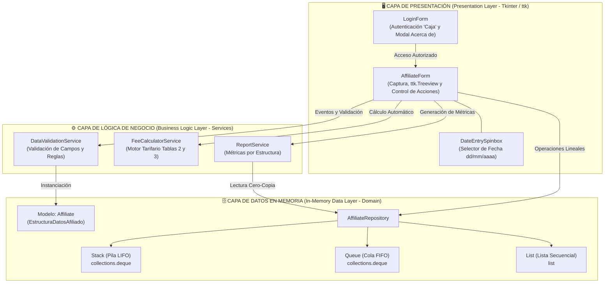

# Fase 3 — Componente Práctico: Prácticas Simuladas (`Fase3FabioGomez`)

**Universidad Nacional Abierta y a Distancia (UNAD)**  
**Escuela de Ciencias Básicas, Tecnología e Ingeniería (ECBTI)**  
**Programa:** Ingeniería de Sistemas  
**Curso:** Estructura de Datos (`301305`)  
**Grupo Colaborativo:** `301305_93`  
**Estudiante:** Fabio Alexmar Gomez Sanmiguel  
**Aplicación:** Caja de Compensación Familiar *"Compensándote"* — Control de Afiliados  

---

## 1. Tabla 1 — Elementos Sugeridos para la Abstracción (Anexo 2)

**Nombre del Estudiante:** Fabio Alexmar Gomez Sanmiguel  
**Planteamiento del Problema:** La Caja de Compensación Familiar *"Compensándote"* requiere una aplicación de escritorio con interfaz gráfica (`Tkinter` / `ttk`) que permita autenticar el acceso mediante la clave estática `Caja`, capturar y validar los datos de afiliación de sus usuarios, calcular automáticamente la tarifa de afiliación según el nivel de ingresos, la modalidad de empleo (`Empleado` o `Independiente`) y el servicio deseado, y gestionar los registros en memoria principal utilizando tres estructuras de datos lineales: **Pila** (`collections.deque` — LIFO), **Cola** (`collections.deque` — FIFO) y **Lista** (`list` — Secuencial), generando reportes estadísticos específicos para cada estructura.

| Nombre de la Clase y su Ámbito de Visibilidad (`Public` / `Private`) | Nombre de las Propiedades y/o Atributos de la Clase con sus Tipos de Datos | Tipo de Estructura que Soporta (`Pila`, `Cola` o `Lista`) | Acciones que Tendrá el Formulario de Ingreso de Datos (Métodos) |
| :--- | :--- | :--- | :--- |
| **Nombre de la clase:** `Affiliate` (Alias: `EstructuraDatosAfiliado` / `AffiliateDataStructure`)<br>**Ámbito de visibilidad:** Pública (`Public Class Affiliate`)<br><br>**Repositorio y Estructuras:**<br>`Public Class AffiliateRepository`<br>`Public Class Stack`<br>`Public Class Queue`<br>`Public Class List`<br><br>**Servicios de Negocio:**<br>`Public Class FeeCalculatorService`<br>`Public Class DataValidationService`<br>`Public Class ReportService`<br><br>**Formularios GUI:**<br>`Public Class LoginForm`<br>`Public Class AffiliateForm` | **Atributos de `Affiliate`:**<br>- `String id_type` (Tipo de identificación: `CC`, `CE`, `NUIP`, `PAS`)<br>- `String id_number` (Número de identificación numérico)<br>- `String full_name` (Nombre completo alfabético)<br>- `Float current_income` (Ingresos actuales $\ge \$1.000.000$)<br>- `String desired_service` (Servicio deseado)<br>- `String employment_mode` (`Empleado` / `Independiente`)<br>- `Float affiliation_fee` (Tarifa de afiliación calculada)<br>- `String affiliation_date` (Fecha en formato `dd/mm/aaaa`)<br><br>**Atributos de `AffiliateRepository`:**<br>- `Stack stack` (`collections.deque`)<br>- `Queue queue` (`collections.deque`)<br>- `List affiliate_list` (`list`) | **Soporta las 3 estructuras lineales en memoria principal:**<br>1. **Pila (`Stack` / `collections.deque`):** Comportamiento LIFO (*Last-In, First-Out* — Apilar al tope y desapilar el último ingresado).<br>2. **Cola (`Queue` / `collections.deque`):** Comportamiento FIFO (*First-In, First-Out* — Encolar al final y desencolar el primero ingresado).<br>3. **Lista (`List` / `list`):** Comportamiento secuencial (Agregar al final y buscar/eliminar por `id_number`). | **Acciones de Autenticación (`LoginForm`):**<br>- `handle_login()` (**INGRESAR**): Valida contraseña (`Caja`) y abre el formulario principal.<br>- `show_about_dialog()` (**ACERCA DE**): Muestra información del curso, estudiante y grupo.<br>- `handle_exit()` (**SALIR**): Cierra la aplicación.<br><br>**Acciones del Formulario Principal (`AffiliateForm`):**<br>- `handle_register()` (**REGISTRAR**): Valida los datos, calcula la tarifa e inserta en la Pila (`push`), Cola (`enqueue`) o Lista (`append_affiliate`).<br>- `handle_delete()` (**ELIMINAR**): Pide confirmación modal y desapila (`pop`), desencola (`dequeue`) o elimina por ID (`remove_by_id`).<br>- `handle_report()` (**REPORTE**): Calcula la suma de tarifas (Pila), conteo de registros (Cola) o promedio de ingresos (Lista).<br>- `handle_clear()` (**LIMPIAR**): Limpia los controles de entrada sin afectar el `Treeview`.<br>- `handle_exit()` (**SALIR**): Finaliza la ejecución de la aplicación. |

---

## 2. Arquitectura del Software (3 Capas)



### Estructura del Proyecto

```text
Fase3FabioGomez/
├── main.py                                    # Punto de entrada principal de la aplicación
├── pyproject.toml                             # Configuración del paquete Python
├── README.md                                  # Documentación y Tabla de Abstracción UNAD
├── src/
│   ├── config/
│   │   └── constants.py                       # Constantes, tarifas y metadatos académicos
│   ├── domain/
│   │   ├── affiliate.py                       # Entidad inmutable Affiliate (EstructuraDatosAfiliado)
│   │   └── data_structures.py                 # Estructuras Stack (deque), Queue (deque) y List (list)
│   ├── services/
│   │   ├── data_validation_service.py         # Validación defensiva de entradas y credenciales
│   │   ├── fee_calculator_service.py          # Cálculo automático de tarifas y recargos
│   │   └── report_service.py                  # Suma (Pila), conteo (Cola) y promedio (Lista)
│   └── presentation/
│       ├── app_controller.py                  # Coordinador de transición entre ventanas
│       ├── login_form.py                      # Ventana Login - Compensándote y modal Acerca de
│       ├── affiliate_form.py                  # Formulario principal y tabla ttk.Treeview
│       ├── formatters.py                      # Formateo visual de moneda y filas
│       ├── theme.py                           # Paleta de colores y estilos ttk
│       └── widgets/
│           └── date_entry_spinbox.py          # Control compuesto DateEntry + Spinbox (dd/mm/aaaa)
└── tests/
    └── test_core.py                           # Suite de pruebas unitarias, valores límite e interfaz
```

---

## 3. Ejecución y Pruebas

### Ejecutar la Aplicación Gráfica:
```bash
python3 main.py
```
- **Contraseña de acceso:** `Caja`

### Ejecutar la Suite de Pruebas Unitarias:
```bash
python3 -m unittest discover -s tests -v
```
